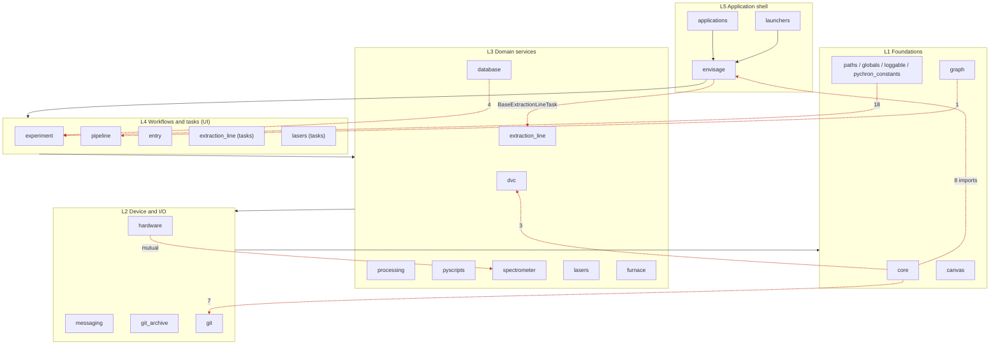
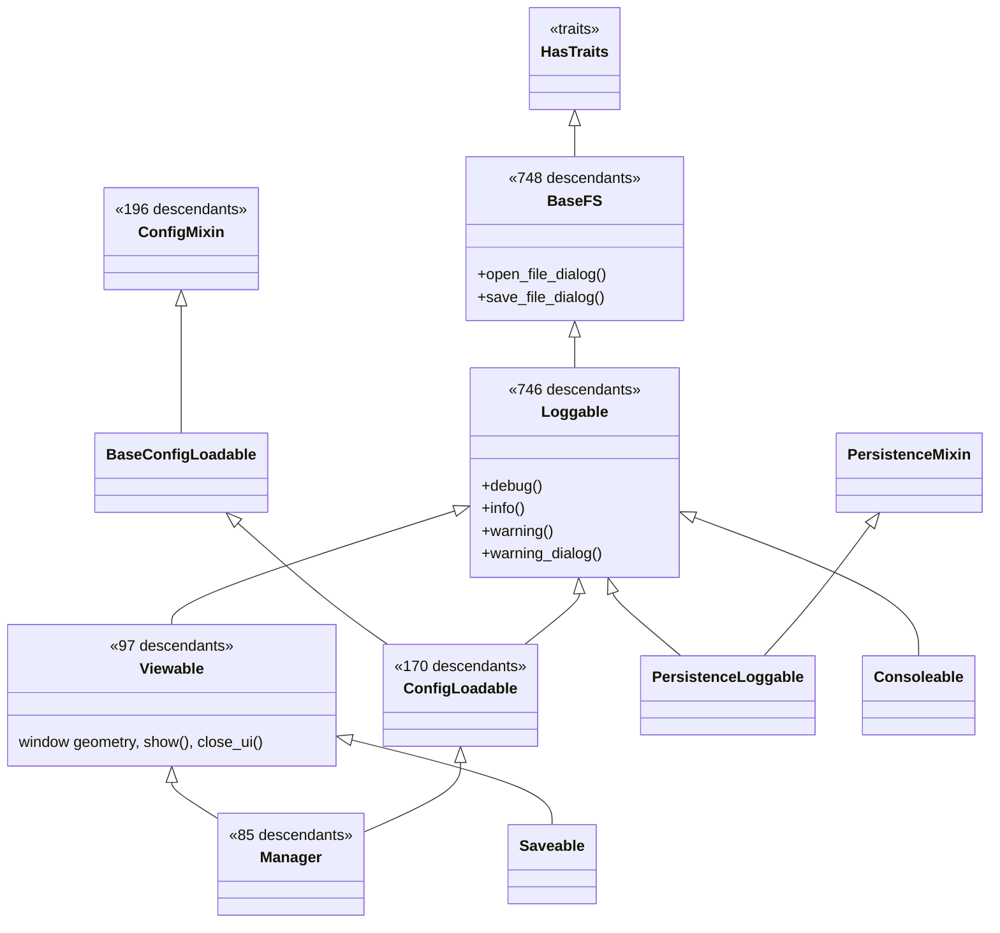
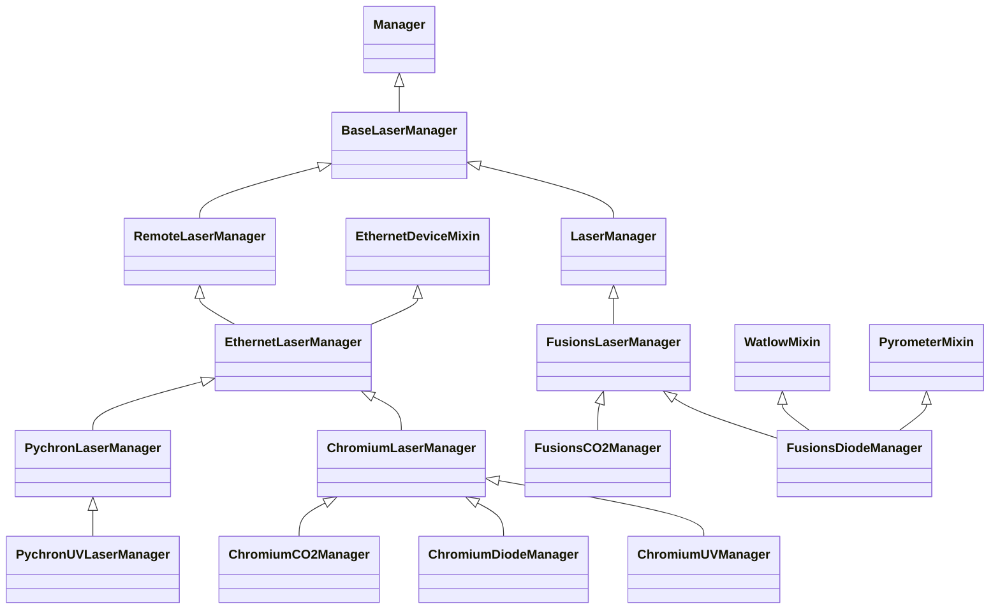
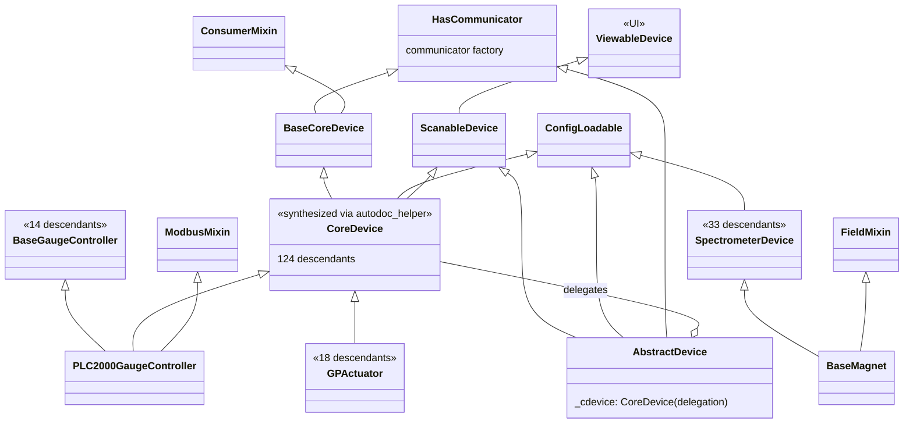
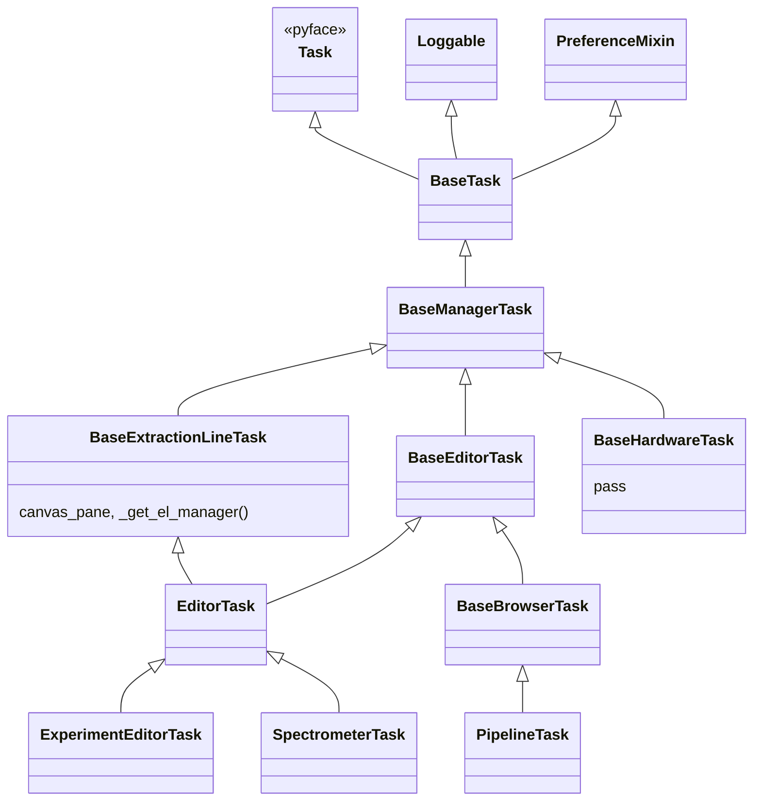
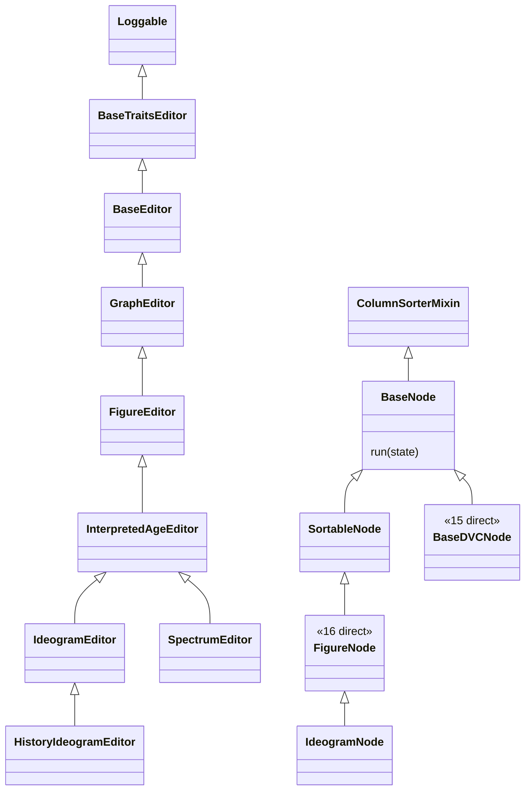
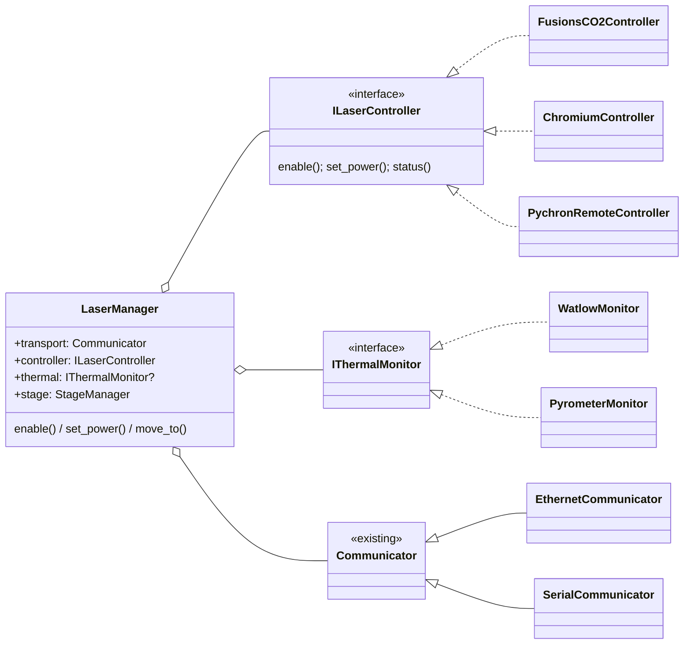
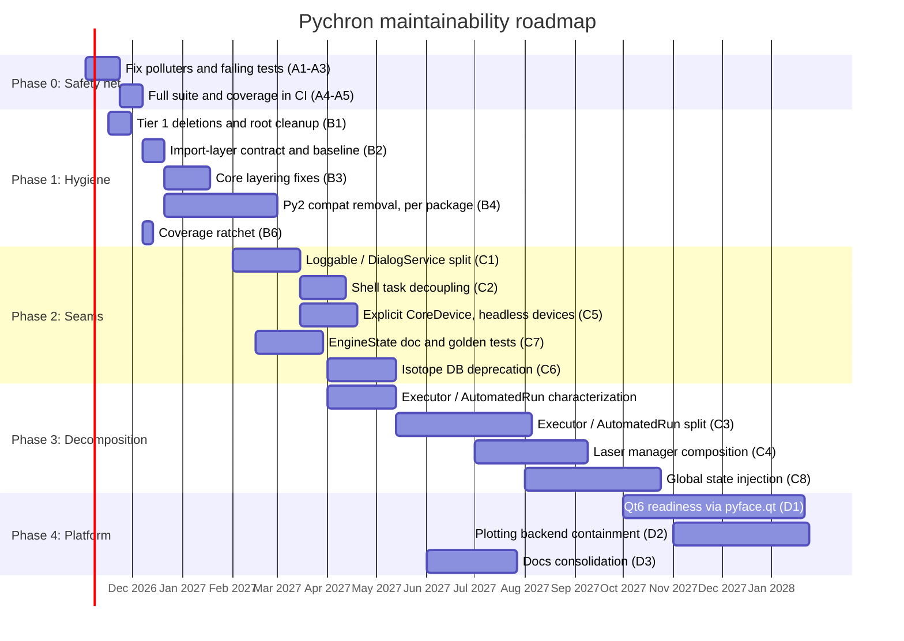

# Pychron Architecture Review (2026-10)

Focus: long-term maintainability, not feature work. Every finding below comes
from measuring the `develop` line at commit `6ccadb4`. The method and the
commands to reproduce it are in the [Appendix](#appendix-a--method-and-reproduction).

---

## 1. Executive Summary

Pychron is a large (~389k LOC, 2,295 modules, ~4,100 classes), long-lived
scientific desktop application. It works and it carries real lab value. The
main maintenance risk is not any one bad module. Four structural traits
reinforce each other:

1. **No layering.** 39 of the 55 top-level packages form one import cycle
   (a single strongly-connected component). `core` imports from `envisage`,
   `git`, `dvc`, `image` and `database`. `envisage` (the app shell) imports from
   `extraction_line`, `lasers`, `experiment` and `hardware`. Because everything
   can reach everything, a change anywhere can break code anywhere.
2. **Inheritance is the default reuse mechanism.** About 746 classes inherit
   `Loggable`, and `Loggable` inherits `BaseFS`, a file-dialog helper. Every
   logger is therefore also a GUI dialog provider. Hierarchies run up to 9
   in-repo levels deep (for example `PychronUVLaserManager`). 303 classes use
   multiple inheritance. The application shell's `EditorTask` inherits
   extraction-line canvas behavior through a diamond.
3. **A thin, partly broken safety net.** CI runs **3** test modules. The full
   suite has 793 tests, of which 32 fail or error because of bit-rot, and two test
   modules corrupt `sys.modules["yaml"]` at import time. When they are
   included, about 30 other test modules fail to import. Measured statement
   coverage of non-test code is **14.7%**, and much of that comes from import
   side effects. Hardware-facing packages are below 5% (`lasers` 3.2%,
   `extraction_line` 2.9%, `furnace` 0.3%, `canvas` 0.4%).
4. **Accumulated sediment.** About 9,850 lines of commented-out code, 977
   files still carrying `from __future__`, 165 files importing `six`, 391
   `__main__` demo blocks inside runtime packages, 6 `.orig`/`.bak` files, a
   stale `setup.py` (version 16.7, `nose`, Travis), and 21 ad-hoc report
   files at the repository root. About 130 modules (~16.6k LOC) have no
   textual reference anywhere in the repo.

### Top recommendations (in priority order)

| # | Action | Why first | Effort |
|---|--------|-----------|--------|
| 1 | **Make the full test suite runnable and run it in CI**: fix the 2 polluting tests, repair or quarantine the 32 failing ones with tracked issues, and remove the repo-root `__init__.py` that breaks pytest | Nothing else can be refactored safely without it | S-M |
| 2 | **Delete the zero-risk sediment** (`.orig`/`.bak`, `~pyproject.toml`, stale `setup.py`, broken `test_suite.py`, root report files moved to `docs/archive/`) | Cheap, reduces noise for every reader and tool | S |
| 3 | **Add an import-layering contract** (for example `import-linter`) that records today's violations and blocks new ones | Stops the cycle from growing while it is worked down | S |
| 4 | **Split `Loggable` from `BaseFS`/dialogs**: logging becomes a composed service, and dialogs move to a UI-only mixin or service | Removes the GUI dependency from about 746 domain and hardware classes | M |
| 5 | **Characterization tests, then decomposition of the 5 god classes** (`ExperimentExecutor`, `AutomatedRun`, `DVC`, `DVCDatabase`, `AutomatedRunFactory`) | They hold the highest-value logic at the lowest coverage | L |
| 6 | **Formally deprecate the legacy Isotope DB path and the Python 2 compatibility layer** | Large surface with no future | M |
| 7 | **Plan the Qt5 to Qt6 move** through `pyface`/`traitsui` (no direct `PyQt5` imports in new code) | Qt 5.15 open-source support has ended; this sets the platform horizon | L |

---

## 2. Codebase at a Glance

### 2.1 Size, tests, documentation and hygiene by package

`Cov%` is measured statement coverage from the full unittest suite (see
section 6). `Doc%` is the share of functions and classes that have a
docstring. `broad` counts `except Exception` handlers. `print` counts
`print()` calls in runtime code. `main` counts files with `__main__` blocks.

| package | files | LOC | classes | Cov% | Doc% | broad | print | main |
|---|---:|---:|---:|---:|---:|---:|---:|---:|
| experiment | 175 | 45,186 | 350 | 25.9 | 18.3 | 66 | 12 | 62 |
| hardware | 292 | 42,715 | 402 | 13.9 | 28.9 | 86 | 56 | 42 |
| pipeline | 195 | 37,603 | 512 | 21.4 | 1.4 | 13 | 4 | 17 |
| core | 246 | 31,176 | 343 | 19.4 | 11.0 | 75 | 95 | 52 |
| lasers | 95 | 21,420 | 233 | **3.2** | 2.4 | 16 | 29 | 22 |
| entry | 102 | 18,032 | 233 | **4.0** | 2.8 | 6 | 33 | 23 |
| spectrometer | 137 | 16,851 | 189 | 8.5 | 5.8 | 12 | 9 | 12 |
| dvc | 50 | 16,526 | 125 | 14.7 | 3.1 | 28 | 39 | 17 |
| processing | 73 | 16,414 | 161 | 25.2 | 4.3 | 10 | 14 | 23 |
| envisage | 69 | 13,619 | 210 | **3.5** | 2.8 | 21 | 22 | 7 |
| canvas | 73 | 13,275 | 125 | **0.4** | 2.7 | 0 | 4 | 3 |
| pyscripts | 58 | 11,656 | 219 | 14.8 | 6.8 | 5 | 6 | 9 |
| database | 45 | 10,012 | 127 | 14.4 | 4.9 | 10 | 6 | 8 |
| extraction_line | 47 | 8,347 | 91 | **2.9** | 7.0 | 12 | 5 | 8 |
| graph | 42 | 8,281 | 68 | 15.2 | 4.2 | 5 | 7 | 8 |
| options | 49 | 7,265 | 147 | 50.5 | 0.2 | 5 | 4 | 3 |
| image | 31 | 6,491 | 63 | 0.8 | 13.3 | 3 | 21 | 4 |
| *(root modules)* | 39 | 6,482 | 41 | 55.6 | 1.5 | 12 | 11 | 7 |
| furnace | 53 | 6,109 | 67 | **0.3** | 1.2 | 0 | 0 | 3 |
| *36 smaller packages* | 424 | 52,001 | 674 | 9.0 | 7.5 | 49 | 79 | 61 |
| **Total** | **2,295** | **389,461** | **4,380** | **14.7** | **9.4** | **434** | **456** | **391** |

### 2.2 Structural map (current)

The diagram groups packages by the role they *should* play. Red edges are
real imports that point the wrong way, from a lower layer to a higher one
(sampled from the measured dependency graph).



### 2.3 Dependency facts

- **Single strongly-connected component of 39 packages.** Every package in
  this list can reach every other one through imports: `(root)`, `canvas`,
  `core`, `data_mapper`, `database`, `dvc`, `entry`, `environment`,
  `envisage`, `experiment`, `external_pipette`, `extraction_line`, `furnace`,
  `git`, `git_archive`, `graph`, `hardware`, `image`, `lasers`, `loading`,
  `logger`, `managers`, `mass_spec`, `mdd`, `messaging`, `monitors`, `mv`,
  `observability`, `options`, `pipeline`, `processing`, `pyscripts`, `social`,
  `spectrometer`, `stage`, `startup_test`, `tx`, `updater`, `user`.
- **59 mutually dependent package pairs** (A imports B and B imports A), for
  example `core`/`envisage`, `core`/`dvc`, `pipeline`/`processing`,
  `experiment`/`pyscripts`, `hardware`/`spectrometer`, `dvc`/`experiment`.
- **Most-imported modules** (fan-in): `pychron.paths` (279),
  `pychron.pychron_constants` (271), `pychron.loggable` (150),
  `core.helpers.traitsui_shortcuts` (121), `core.helpers.filetools` (98),
  `pychron.globals` (65). Two of these are mutable global singletons
  (`paths`, `globalv`, with 191 `globalv.` references), and they act as
  hidden coupling across the whole tree.
- **Concrete layering violations in `core`:**
  - `core/helpers/exception_helper.py` imports `pychron.git.tasks.github_auth`.
  - `core/ui/qt/*` and `core/fits/*` import `pychron.envisage.*` for icons and editors.
  - `core/test_helpers.py` imports `dvc`, `database` and `mass_spec`.
- **Dynamic imports by string** (`HW_PACKAGE_MAP`, `__import__(pkg, fromlist=[klass])`
  in about 15 places, and communicators resolved as `"{}Communicator"`). These hide
  real dependencies from static tools, so dead-code and layering analysis has
  to treat them as registries.

---

## 3. Class Hierarchy Visualizations

All in-repo hierarchies end at `traits.HasTraits`. The counts are transitive
in-repo descendants, measured from the AST. Duplicate class names make the
counts approximate (146 class names are defined more than once).

### 3.1 The root chain: logging, file dialogs, windows and configuration fused



**Reading:** to get a logger you must also be a file-dialog host. To be a
`Manager` (most hardware and workflow controllers) you must also be a window
(`Viewable`), a config loader, and a logger. These are four unrelated concerns
fixed at the base of the tree.

### 3.2 Deepest hierarchy: laser managers (9 in-repo levels)



Full chain for the deepest leaf:
`PychronUVLaserManager -> PychronLaserManager -> EthernetLaserManager -> RemoteLaserManager -> BaseLaserManager -> Manager -> Viewable -> Loggable -> BaseFS -> HasTraits`.

Transport (`Ethernet...`, `Remote...`), vendor (`Chromium`, `Fusions`,
`Pychron`), and wavelength or technology (`CO2`, `Diode`, `UV`) are three
independent axes. All three are encoded in the class hierarchy, which is why
the number of classes grows multiplicatively. This is the clearest case for
composition in the codebase (section 4.3).

### 3.3 Hardware devices: a class synthesized at runtime, plus parallel hierarchies



Observations:

- `CoreDevice` is created with `autodoc_helper("CoreDevice", (BaseCoreDevice, ConfigLoadable, ScanableDevice))`
  in `pychron/hardware/core/core_device.py`. Static tools, IDEs and type
  checkers cannot see its bases.
- Every device inherits a UI concern (`ViewableDevice`) and, through
  `ConfigLoadable -> Loggable -> BaseFS`, a dialog concern.
- `AbstractDevice` already uses **composition and delegation** (`_cdevice` with
  `DelegatesTo`). It is the right pattern, but it sits beside the inheritance
  hierarchy instead of replacing it.
- Communicators are **already composed** (`HasCommunicator` builds a
  communicator object). This seam works well and should be extended.

### 3.4 Application shell tasks: a diamond that drags extraction-line logic into every editor



`pychron/envisage/tasks/base_task.py` defines `BaseExtractionLineTask`. It
looks up the `ExtractionLineManager` service and builds a `CanvasDockPane`. So
the generic shell layer knows about a specific instrument subsystem, and
`ExperimentEditorTask` and `SpectrometerTask` get that behavior through
inheritance. Two different classes are both named `BaseLaserTask`
(`lasers/tasks/laser_task.py` and `lasers/tasks/laser_calibration_task.py`).

### 3.5 Pipeline: nodes are healthy; editors are deep



`PipelineEngine` composes `BaseNode`s into a pipeline. This is a sound
strategy and chain-of-responsibility design, and the right model for the rest
of the code. The figure editors, in contrast, stack six levels of behavior.
`EngineState` is an implicit contract between nodes, and it is not documented.

### 3.6 Inheritance statistics

| metric | value |
|---|---:|
| classes (non-test) | 4,076 |
| classes using multiple inheritance | 303 (7.4%) |
| distinct `*Mixin` bases | 40 (top: `BaseMixin` 77, `NameMixin` 29, `IDMixin` 18, `ColumnSorterMixin` 12) |
| in-repo inheritance depth histogram (levels: count) | 0: 157, 1: 1451, 2: 866, 3: 542, 4: 297, 5: 223, 6: 193, 7: 97, 8: 43, 9: 7 |
| classes 6 or more in-repo levels deep | 340 |
| most-subclassed in-repo bases | `Loggable` (148 direct), `CoreDevice` (62), `BaseTaskPlugin` (42), `BasePreferencesHelper` (50), `SubOptions` (37), `BaseNode` (28) |
| class names defined more than once | 146 |

---

## 4. Composition vs. Inheritance

### 4.1 Diagnosis

Pychron inherited the Enthought idiom of "everything is a `HasTraits`, so put
shared behavior in a base class". Over 15 years this produced:

- **Base-class gravity.** Useful helpers were added to `BaseFS`, `Loggable`,
  `Viewable` and `Manager` because those classes were already everywhere. Every
  subclass then inherited behavior it did not need (GUI dialogs in hardware
  drivers: 67 files in `hardware`, `spectrometer`, `lasers`, `extraction_line`,
  `experiment` and `dvc` call `self.*_dialog`).
- **Axis explosion.** Independent variation axes (vendor x transport x
  technology for lasers; spectrometer vendor x model x plugin) are encoded as
  subclass chains, which multiplies classes and duplicates overrides.
- **Diamonds and implicit MRO contracts.** 303 classes use multiple
  inheritance. `EditorTask(BaseExtractionLineTask, BaseEditorTask)` depends on
  MRO ordering to work at all.
- **Testability cost.** You cannot build an `AutomatedRun` or a laser manager
  in a test without dragging in Qt, `paths`, `globalv` and the logger
  registry. This is a direct cause of the low coverage in section 6.

### 4.2 Guiding rule going forward

> **Inherit for "is-a" contracts that come from a framework (`HasTraits`,
> pyface `Task`, envisage `Plugin`, `TraitsDockPane`). Compose everything
> else: logging, configuration, persistence, UI dialogs, transport, and
> vendor-specific protocol.**

Concretely:

| Concern | Today (inherit) | Target (compose) |
|---|---|---|
| Logging | `Loggable` base | `self.log = get_logger(name)` or a small `LoggerMixin` with no UI imports. Keep `Loggable` as a thin compatibility shim during migration |
| File and confirmation dialogs | `BaseFS` / `Loggable.warning_dialog` | An injected `DialogService` (a Protocol). The headless implementation logs or raises, the Qt implementation shows dialogs |
| Window behavior | `Viewable` on `Manager` | Managers are plain services. A separate view or `Controller` wraps them (TraitsUI already supports `Controller(model=...)`) |
| Configuration | `ConfigLoadable` / `ConfigMixin` base | A `DeviceConfig` value object parsed once and passed in |
| Transport | `EthernetLaserManager`, `ModbusMixin`, `RemoteDeviceMixin` | `Communicator` instance, as `HasCommunicator` already does |
| Vendor protocol | Subclass per vendor | A `Protocol`/`Interface` plus a strategy object chosen by config |
| Extraction-line canvas in tasks | `BaseExtractionLineTask` in the shell | A pane contributed through an envisage extension point by the extraction-line plugin |
| Device class assembly | `type()` via `autodoc_helper` | An explicit `class CoreDevice(...)` declaration |

### 4.3 Worked example: laser managers



The 9-level chain becomes one manager plus small strategies. The YAML or INI
device configuration already names the vendor and transport, so a factory can
assemble the composite. Each strategy can be unit-tested with a fake
`Communicator`. The same shape applies to spectrometers (magnet, source and
detectors are already partly composed in `BaseSpectrometer`) and to furnaces.

### 4.4 Existing patterns to copy

- `HasCommunicator` plus the communicator classes (transport composed, not inherited).
- `AbstractDevice` delegating to `_cdevice`.
- `PipelineEngine` plus `BaseNode` (pipelines composed from nodes).
- `pychron/experiment/automated_run/state_machine.py` (explicit state
  transitions instead of flags spread across a god class).

### 4.5 Migration tactic (low regression)

1. Introduce the composed service next to the inherited behavior (for example,
   `Loggable` keeps working but delegates to a `LogService`).
2. Move one leaf class at a time, with characterization tests around it.
3. Once the base method has no callers, mark it with `pychron.deprecate`, then
   remove it one release later.
4. Never refactor a hierarchy and change behavior in the same PR.

---

## 5. God Classes and Hotspots

| class | file | lines | methods | notes |
|---|---|---:|---:|---|
| `ExperimentExecutor` | `experiment/experiment_executor.py` | 3,540 | 132 | 204 distinct `self.` attributes, 63 imports |
| `AutomatedRun` | `experiment/automated_run/automated_run.py` | 3,412 | 152 | 167 distinct `self.` attributes |
| `IsotopeAdapter` | `database/adapters/isotope_adapter.py` | 2,859 | 237 | legacy DB, candidate for deprecation |
| `DVCDatabase` | `dvc/dvc_database.py` | 2,555 | 175 | query surface for all of DVC |
| `DVC` | `dvc/dvc.py` | 2,485 | 146 | repository, DB and cache facade |
| `AutomatedRunFactory` | `experiment/automated_run/factory.py` | 1,910 | 127 | UI and spec construction mixed |
| `Toupcam` | `image/toupcam/toupcam.py` | 1,826 | 149 | vendor SDK wrapper; Windows-only import |
| `XLSXAnalysisTableWriter` | `pipeline/tables/xlsx_table_writer.py` | 1,578 | 44 | |
| `GitRepoManager` | `git_archive/repo_manager.py` | 1,487 | 94 | |
| `ExtractionLineManager` | `extraction_line/extraction_line_manager.py` | 1,346 | 109 | 2.9% package coverage |

31 files are longer than 1,000 lines. Suggested decomposition seams:

- **ExperimentExecutor:** queue scheduling, run lifecycle and state machine,
  pre/post-run checks (conditionals, monitors), hardware readiness, and
  notification and telemetry. These become collaborators the executor
  orchestrates.
- **AutomatedRun:** spec and scripts, data collection (already partly in
  `data_collector.py`), persistence (already in `persistence.py`), and UI and
  plot updates. The UI part is a recurring source of thread-marshalling bugs;
  see the last three commits on this branch.
- **DVC / DVCDatabase:** split by aggregate (analyses, irradiation, samples,
  repositories) behind the existing `DVC` facade, so callers do not change.

---

## 6. Test Coverage

### 6.1 What CI actually runs

`.github/workflows/ci.yml` runs Black and mypy on **changed files only**, and
unit tests for **three modules**:

```
pychron.core.tests.import_hygiene_test
pychron.experiment.tests.queue_metadata
pychron.experiment.tests.pyscript_integration
```

No other test in the repository gates a merge.

### 6.2 What the full suite looks like

Run with Python 3.12, PyQt5, headless (`xvfb`, `QT_QPA_PLATFORM=offscreen`),
`unittest discover -s pychron -t . -p "*test*.py"`:

| run | tests | failures | errors | notes |
|---|---:|---:|---:|---|
| naive full discovery | 735 | 10 | 37 | about 30 modules fail at import with `'types.SimpleNamespace' object has no attribute 'FullLoader'` |
| excluding 2 polluting modules | **793** | **11** | **21** | the remaining failures are real bit-rot |

**Polluting tests:** these two modules assign `sys.modules["yaml"] = SimpleNamespace(...)`
at import time and never restore it:

- `pychron/core/helpers/tests/logger_setup_test.py`
- `pychron/extraction_line/tests/network_state_test.py`

Fix: use `unittest.mock.patch.dict(sys.modules, {...})` inside `setUp` or as a
context manager.

**Bit-rot examples** (tests that drifted from the code because nothing ran them):

- `experiment/tests/analysis_grouping_test` calls the removed `AutomatedRunPersister._save_analysis_group`.
- `experiment/tests/reset_queues_test`: `MockRun` lacks the new `transition` API.
- `experiment/tests/test_state_machines`: `NameError: OVERLAP_ALLOWED`, plus 2 assertion failures.
- `experiment/telemetry/tests/test_cli`: 7 failures, because the CLI help output changed.
- `database/test_database` imports the removed `make_runid`.
- `hardware/tests/test_phase3`, `hardware/tests/test_phase4`: 3 errors in config and report generation.
- `processing/tests/analysis_view_test`: reuse assertion fails.
- Several `*_tester.py` and `*test*.py` runtime modules are picked up by
  discovery and fail on import (`pychron/test_suite.py` and `dvc/poc_test.py`
  force the `qt4` toolkit; `lasers/pattern/seek_tester.py` imports a removed
  name; `mv/mv_manager_tester.py` imports `numpy.lib.function_base`, which
  NumPy 2 removed).

**Tooling traps:**

- The repository root contains an `__init__.py`, so pytest treats the checkout
  as a package named `pychron`, and every test fails with
  `No module named 'pychron.core'`. Removing it (after confirming no launcher
  relies on it) makes pytest usable.
- `test/` (34 files with tests) is outside the discovery path, excluded from
  Black and mypy, and not run anywhere.

### 6.3 Measured statement coverage (non-test code)

Coverage here includes statements executed at import time (class bodies,
module constants). Behavioral coverage is lower than these numbers.

```
package          stmts   cov%
options           2665   50.5  ##########
mass_spec         1092   42.4  ########
git                916   27.9  #####
experiment       17147   25.9  #####
processing        7479   25.2  #####
git_archive       1860   21.7  ####
pipeline         16809   21.4  ####
dashboard         1007   19.8  ####
core             12996   19.4  ###
graph             4226   15.2  ###
pyscripts         4970   14.8  ##
dvc               8453   14.7  ##
database          4133   14.4  ##
hardware         16325   13.9  ##
spectrometer      7244    8.5  #
envisage          6390    3.5  .
lasers            8615    3.2  .
entry             7316    4.0  .
extraction_line   4078    2.9  .
image             3201    0.8  .
canvas            6593    0.4  .
furnace           2662    0.3  .
stage             1266    0.0  .
tx / gis / monitors / classifier / igsn / geochron / usage / ...   0.0
--------------------------------
TOTAL (non-test) 165923  14.7
```

### 6.4 Test priorities (maintenance-driven)

1. **Restore the net:** fix the 2 polluters and the 32 failures (or mark them
   `@unittest.expectedFailure` with an issue link). Rename runtime `*_tester.py`
   and `poc_test.py` so discovery skips them. Then switch CI to full discovery
   and fail the build on regressions.
2. **Characterization tests before refactors** for `ExperimentExecutor`,
   `AutomatedRun` and its state machine, `DVC` save and load round-trip, and
   `PipelineEngine` with representative pipeline templates. Freeze current
   outputs (golden files) instead of asserting ideal behavior.
3. **Transcript tests for hardware:** record and replay communicator traffic
   (there is already a `response_recorder.py` at the root). Target
   `extraction_line` valves and switches, laser enable and power, and NGX
   acquisition first, because a wrong state there is physically consequential.
4. **Numerical regression tests** for `processing` (age, J, plateau,
   isochron) against published reference datasets. These are the
   scientific-correctness guarantees.
5. **Coverage gate:** report coverage in CI now, then add a ratchet (coverage
   may not drop) once the suite is green. Target 30% by mid-2027 and 50% on
   `experiment`, `dvc`, `processing` and `pipeline` by 2028.
6. Adopt **pytest** as the runner (it runs existing `unittest` tests) once the
   root `__init__.py` is gone. This gives fixtures, isolation and markers
   (`@pytest.mark.qt` and `@pytest.mark.hardware`).

---

## 7. Documentation

### 7.1 Inventory

| location | content | state |
|---|---|---|
| `README.md`, `AGENTS.md`, `architecture.md` | orientation | good, current |
| `docs/` (Sphinx) | `dev_guide/`, `user_guide/`, `api/`, `architecture/` | partly current; `api/` covers only 10 areas |
| `docs-site/` (Docusaurus) | a second docs site with a blog | **duplicates `docs/`**; two systems to maintain |
| `pychron/*/architecture.md`, `README.md`, `AGENTS.md` | subsystem notes (`experiment`, `hardware`, `dvc`, `envisage`, `canvas`, `extraction_line`) | useful; good model |
| `docs/ai/*.yaml` | class index, module map, plugin registry | generated; needs a regeneration script and CI check |
| 21 root-level `*.md`/`*.txt` reports | task reports (`PHASE_6_SUMMARY`, `SEARCH_RESULTS_INDEX`, `PROMETHEUS_*`, `TELEMETRY_*`, and others) | **point-in-time artifacts** that crowd the root and go stale |
| docstrings | 9.4% of functions and classes | `pipeline` 1.4%, `options` 0.2%, `canvas` 2.7%, `lasers` 2.4% |

### 7.2 Documentation needs (priority order)

1. **Layering and dependency rules** (from section 2.2) as a short
   `docs/architecture/layers.md`, enforced by the import contract.
2. **Pipeline `EngineState` contract:** which node reads and writes which
   fields. This is the top source of silent breakage when nodes are reordered.
3. **Device configuration reference:** generate it from `HW_PACKAGE_MAP` and
   the device classes. `docs_hardware.py` and `hardwaredocs.md` attempt this
   today.
4. **Experiment execution lifecycle:** states and transitions from
   `state_machine.py`, as a diagram kept next to the code.
5. **Thread model:** what may run off the main thread and when
   `invoke_in_main_thread` is required. There are 192 call sites and about 100
   modules using threads, and recent fixes on this branch are thread-marshalling bugs.
6. **Docstring policy for touched code:** public classes and methods in
   `experiment`, `dvc`, `pipeline` and `processing` get a one-line docstring
   when edited. Do not mass-generate docstrings.
7. **Consolidate on one docs system** (Sphinx or Docusaurus). Move root reports
   to `docs/archive/` with a dated index, or delete the ones that only recorded
   completed work.

---

## 8. Remove / Deprecate

The tiers are ordered by risk. "Unreferenced" means the module's dotted path
and leaf name appear nowhere else in `pychron/`, `launchers/`, or config
files, **after** accounting for dynamic communicator loading. Each one still
needs an owner check before deletion, because lab-specific configs outside the
repo may name it.

### Tier 1: delete now (no runtime path)

| item | reason |
|---|---|
| `pychron/envisage/tasks/base_task.py.orig`, `pychron/experiment/automated_run/spec.py.orig`, `pychron/extraction_line/valve_manager.py.orig`, `pychron/lasers/power/power_mapper.py.orig`, `pychron/managers/data_managers/h5_data_manager.py.orig`, `pychron/extraction_line/tasks/extraction_line_pane.py.bak` | merge leftovers |
| `~pyproject.toml` | empty editor artifact |
| `setup.py` | stale (version 16.7, `nose`, Travis); `pyproject.toml` plus `uv` is authoritative |
| `pychron/test_suite.py` | broken aggregate runner (forces the `qt4` toolkit) |
| `app_utils/*.sql` dumps (2021) | data snapshots do not belong in source control |
| `sandbox/` | experiments; move anything still useful into `docs/` examples |
| `pychron/dvc/fix/*` (6 one-off fix scripts) | completed data migrations; keep in git history |
| Root report files (section 7.1) | move to `docs/archive/` or delete |

### Tier 2: deprecate, then remove after one release

| item | size | reason |
|---|---|---|
| Legacy **Isotope DB** (`database/adapters/isotope_adapter.py`, `database/orms/isotope/`, `database/isotope_importer.py`) | ~4.6k LOC | superseded by DVC; still referenced by 9 modules (`analysis_view`, `browser_task`, `j_transfer`, `gains_edit_view`, `image_browser`, `entry/legacy`, test helpers). Cut those references first |
| **Python 2 compatibility layer**: `from __future__` (977 files), `six` (165 files), `super(Cls, self)` (820 calls) | mechanical | Python is pinned `==3.12.*`. Run `pyupgrade --py312-plus` one package per PR, then drop the `six` dependency |
| **qt4 and PySide references** in runtime files (`database/mass_spec_recaller.py`, `processing/utils/equil.py`, `experiment/rotated_graphic_generator.py`, `lasers/power/power_calibration_manager.py`, `core/helpers/m3_diagnostics.py`, `core/ui/preference_binding.py`, `core/ui/qt/gif_splash_screen.py`) | 7 files | AGENTS.md forbids them; they block a Qt6 move |
| `__main__` demo blocks in runtime modules | 391 files | keep (per AGENTS.md) but stop adding new ones; move larger demos to `docs/examples/` over time |
| `CoreDevice` built with `autodoc_helper(type(...))` | 1 site | replace with an explicit class |
| `BaseFS` dialogs on `Loggable` | 748 descendants | see section 4. Deprecate `open_file_dialog` and related methods on non-UI classes |
| `docs_hardware.py`, `docs_pyscript.py`, `pychron/hardwaredocs.md` | small | replace with a generated device reference (section 7.2) |
| One of `docs/` or `docs-site/` | | two docs systems |
| 13 `SyntaxWarning: invalid escape sequence` sites | 13 files | these become errors in a future Python; convert them to raw strings |

### Tier 3: evaluate with lab owners (unreferenced or untested)

About **130 unreferenced modules, ~16.6k LOC**. The largest:

`pychron/pyscripts/parameter_editor.py` (876), `pychron/canvas/canvas2D/markup/markup_items.py` (860),
`pychron/dvc/iso_db_transfer.py` (932), `pychron/processing/autoupdate_parser.py` (691),
`pychron/messaging/testclient.py` (549), `pychron/managers/bandwidth_imager.py` (465),
`pychron/experiment/image_browser.py` (320), `pychron/spectrometer/jobs/magnet_scan.py` (319),
`pychron/mv/mv_manager_tester.py` (295), `pychron/experiment/selection_view.py` (289),
`pychron/lasers/registered_image_viewer.py` (282), `pychron/messaging/directory_server.py` (276),
`pychron/dvc/offline_index.py` (268), `pychron/entry/mass_spec_reverter.py` (261),
`pychron/extraction_line/extraction_line_learner.py` (248), `pychron/lasers/power/composite_calibration_manager.py` (243),
`pychron/core/ui/qt/text_table_editor.py` (242).

The full list can be regenerated with the script in the Appendix.

Small packages with **0% coverage** that need an owner decision (keep and test,
move to an optional plugin, or retire): `gis`, `igsn`, `geochron`,
`ausgeochem`, `sparrow`, `social`, `media_storage`, `ml`, `classifier`,
`usage`, `labbook`, `bakeout`, `watchdog`, `tx`, `monitors`.

---

## 9. Prioritized Action Plan

Priority: **P0** blocks safe change, **P1** high leverage, **P2** structural,
**P3** platform. Effort: S < 1 week, M 1-4 weeks, L > 1 month (one developer).

| ID | Pri | Action | Effort | Success measure |
|---|---|---|---|---|
| A1 | P0 | Fix the 2 `sys.modules` polluting tests with `mock.patch.dict` | S | full discovery has no `SimpleNamespace` errors |
| A2 | P0 | Repair or `expectedFailure` the 32 failing tests, each with an issue | S-M | 0 unexpected failures |
| A3 | P0 | Rename runtime `*_tester.py`/`poc_test.py` so test discovery skips them; delete `pychron/test_suite.py` | S | discovery imports only real tests |
| A4 | P0 | CI: run full discovery under `xvfb`, publish a coverage report (not a gate yet) | S | CI shows about 790 tests |
| A5 | P0 | Remove repo-root `__init__.py` (verify launchers first); enable pytest | S | `pytest pychron` collects |
| B1 | P1 | Tier 1 deletions (section 8) | S | root contains only living docs |
| B2 | P1 | Add `import-linter` with a layers contract plus a baseline of current violations | S | no *new* upward imports |
| B3 | P1 | Fix the `core` layering violations (icons, `github_auth`, `test_helpers`) | M | `core` imports nothing above L1 |
| B4 | P1 | `pyupgrade --py312-plus` and drop `six`, package by package | M | 0 `six` imports |
| B5 | P1 | Fix the Black `extend-exclude` regex (currently a character class `^/[docs\|sandbox...]`) and the `include` pattern | S | config matches intent |
| B6 | P1 | Coverage ratchet in CI | S | coverage can only go up |
| C1 | P2 | Split `Loggable` from `BaseFS`; introduce `DialogService` | M | domain classes import no pyface |
| C2 | P2 | Extract the `BaseExtractionLineTask` canvas pane into an extension-point contribution | M | `envisage` does not import `extraction_line` |
| C3 | P2 | Characterization tests, then decompose `ExperimentExecutor` and `AutomatedRun` | L | each under 1,500 lines; executor coverage at least 50% |
| C4 | P2 | Laser manager composition (section 4.3) | L | depth at most 4; vendor, transport and thermal as strategies |
| C5 | P2 | Explicit `CoreDevice` class; remove UI (`ViewableDevice`) from the device base | M | devices constructible headless |
| C6 | P2 | Deprecate the Isotope DB path (Tier 2) | M | 0 imports outside `database/legacy` |
| C7 | P2 | Document the `EngineState` contract plus pipeline golden tests | M | doc plus tests per default template |
| C8 | P2 | Replace `paths` and `globalv` global reads in domain code with injected settings | L | fan-in of `globals` drops by half |
| D1 | P3 | Qt6 readiness: no direct `PyQt5` in new code, go through `pyface.qt`; trial PySide6 in CI | L | app boots on Qt6 in CI |
| D2 | P3 | Evaluate the long-term risk of Chaco (plotting) and confine it behind `graph/` | L | no Chaco imports outside `graph`/`pipeline.plot` |
| D3 | P3 | Consolidate the docs system; generate the API and device reference | M | one docs build in CI |

---

## 10. High-Level Roadmap



| Phase | Window | Exit criteria |
|---|---|---|
| 0: Safety net | Nov-Dec 2026 | full suite green in CI; coverage visible |
| 1: Hygiene | Nov 2026-Mar 2027 | no Tier 1 debris; layer contract in CI; `core` clean; no `six` |
| 2: Seams | Feb-May 2027 | domain classes headless-constructible; shell independent of instruments |
| 3: Decomposition | Apr 2027-Jan 2028 | no class over 1,500 lines in `experiment`/`dvc`; laser depth at most 4 |
| 4: Platform | Q4 2027-2028 | boots on Qt6 in CI; one docs system |

---

## 11. Fitness Functions (track per release)

| metric | now | 2027 target | 2028 target |
|---|---:|---:|---:|
| tests run in CI | 3 modules | full suite (about 800 tests) | 1,500+ |
| non-test statement coverage | 14.7% | 30% | 45% |
| packages in the largest import cycle | 39 | 25 | 10 |
| mutual package pairs | 59 | 30 | 10 |
| classes deriving from `BaseFS` (dialogs) | ~748 | UI classes only | UI classes only |
| max in-repo inheritance depth | 9 | 7 | 5 |
| files over 1,000 lines | 31 | 25 | 15 |
| files with `six`/`__future__` | 165 / 977 | 0 / 0 | 0 / 0 |
| commented-out code lines (heuristic) | ~9,850 | 5,000 | 2,000 |
| docstring share | 9.4% | 15% | 25% |
| root-level report files | 21 | 0 | 0 |

---

## Appendix A: Method and reproduction

- **Static analysis:** Python `ast` walk over `pychron/**/*.py`. It collects
  classes and bases, functions, docstrings, `except` handlers, `print()` calls,
  imports (relative imports resolved), and `__main__` blocks. Inheritance is
  resolved by simple class name, so the 146 duplicated names make descendant
  counts approximate. External bases (`HasTraits`, pyface `Task`) end the
  chain.
- **Import graph:** module-level `import`/`from` edges resolved to the
  longest matching in-repo module, collapsed to top-level packages, and
  strongly-connected components computed with Tarjan's algorithm. Dynamic
  `__import__`/`HW_PACKAGE_MAP` loads are invisible to this graph.
- **Unreferenced modules:** never statically imported, **and** the leaf
  module name does not appear as a whole word in any `.py`, `.yaml`, `.txt`,
  `.cfg`, `.toml` or `.json` file under `pychron/`, `launchers/`, or
  `pyproject.toml`, with the dynamically loaded `*_communicator` modules
  removed.
- **Tests and coverage:**

  ```bash
  uv sync --group dev --no-install-project
  ```

  ```bash
  uv pip install coverage
  ```

  ```bash
  PYTHONPATH=. QT_QPA_PLATFORM=offscreen ETS_TOOLKIT=qt QT_API=pyqt5 \
    xvfb-run -a uv run --no-sync python -m coverage run --source=pychron \
    -m unittest discover -s pychron -t . -p "*test*.py"
  ```

  For the "excluding polluters" numbers, the loader's `_match_path` was
  overridden to skip `logger_setup_test.py` and `network_state_test.py`.
- **Environment:** Linux, Python 3.12, PyQt5 5.15, headless. `cv2` and
  Windows-only `ctypes.windll` were unavailable, which accounts for 2 import
  errors.
