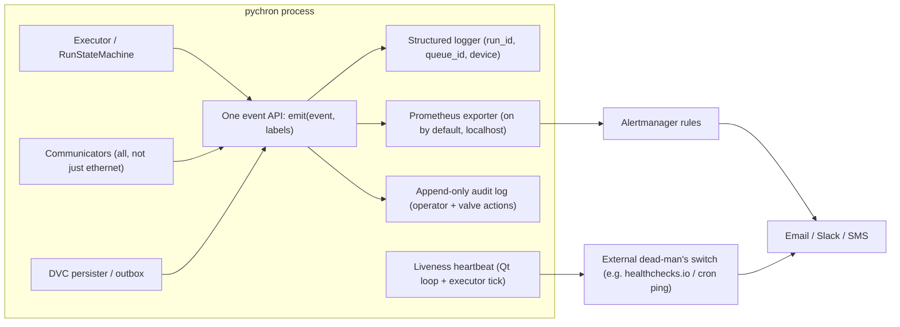
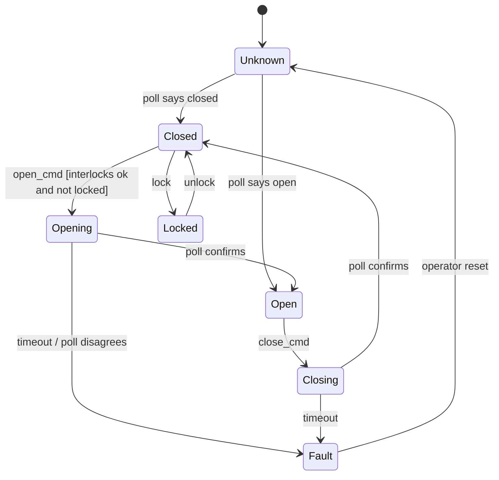
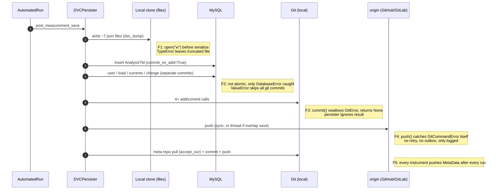
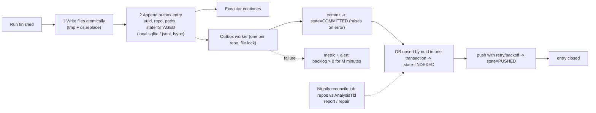

# Pychron Capability Gap Analysis (2026-10)

Companion to [architecture-review-2026.md](architecture-review-2026.md). That
review covers structure. This document covers **missing or unreliable runtime
capabilities**: observability and monitoring, explicit state management, and
the DVC persistence split between Git and MySQL. It finishes with other
cross-cutting gaps and a prioritized plan.

Measured on `main` at `6ccadb4` (2026-06-28). Findings come from reading the
source and running the module test suites locally. No live MySQL server, Git
remote or instrument hardware was exercised. Every finding cites `file:line`
so it can be checked.

---

## 1. Summary

| Area | Verdict | Most important finding |
|---|---|---|
| Observability and monitoring | **About 6k LOC written; little of it runs** | With default settings an overnight run produces only a rotating text log and main-thread stall dumps. Nothing alerts on a hang, crash or device fault. The shipped Grafana dashboards query metric names the code does not emit. |
| State machines | **Present but advisory** | Four state machines exist for executor, queue and run, but state is still driven by about 22 boolean flags across `ExperimentExecutor`, `AutomatedRun` and `DataCollector`. Valves, lasers, NGX acquisition, pyscripts, furnace dumps and device connections have no explicit state model. |
| DVC (Git plus MySQL) | **Split is sound; orchestration is not safe** | Commit and push failures are swallowed. The DB insert is non-atomic and is committed before Git. A conflict prompt can `reset --hard` to the remote. Queue start auto-resets the working tree. Together these allow **silent data loss** and Git/DB drift, and there is no reconciliation tool. |
| Other | **Missing foundations** | No config schema validation (6 config formats, 0 validation libraries). DB passwords are stored in plaintext preferences. 146 raw `Thread()` call sites against 11 locks. No operator audit trail. |

Highest-value fixes, in order:

1. Make Git commit and push failures **loud and retried**, through a persistent outbox.
2. **Remove the automatic destructive resets** in the DVC sync path.
3. Add a **dead-man's-switch alert** for unattended runs.
4. Make the existing state machines **authoritative** for run lifecycle and fix the broken telemetry listener.
5. Build a **Git to MySQL reconcile job**.

---

## 2. Observability and Monitoring

### 2.1 What exists and what actually runs

| Capability | Exists | On by default | Evidence | Gap |
|---|---|---|---|---|
| Prometheus metrics | yes | **no**, double opt-in | `PrometheusPlugin` must be listed in initialization.xml (`envisage/pychron_run.py:113,222`), and then `enabled=False` (`observability/config.py:16`) | About 12 production call sites; no histograms emitted in production |
| Grafana dashboards | 2 JSON files plus `prometheus.yml` in `ops/` | not deployed | `ops/grafana/dashboards/*.json` | Panels query `pychron_runs_started_total`, `pychron_active_runs`, `pychron_service_health_state`; the code emits `pychron_run_started`, `pychron_queue_started` and similar. No alert rules and no Alertmanager |
| Structured telemetry (JSONL) | yes | **no**, needs env var `PYCHRON_TELEMETRY_ENABLED` | `globals.py:122,130`; `state_machines/controller.py:153-160` | Writes to `~/.pychron_telemetry/logs`, outside `paths.log_dir`, with no rotation; flushes every 100 events (`recorder.py:57`) |
| Tracing spans | yes | only with telemetry on | 2 spans: extraction and measurement (`experiment_executor.py:2095,2159`) | No spans around save, DVC, Git or DB |
| Structured or correlated logs | **no** | n/a | plain-text format (`core/helpers/logger_setup.py:33`); `Loggable._log_` adds no context (`loggable.py:232-255`) | Run and queue IDs are not on log lines |
| Log rotation | yes | yes | 100 MB x 50 (`logger_setup.py:194`) | `check_log_disk_usage` (`:242`) is never called |
| Device heartbeats | yes | **no**, needs `PYCHRON_WATCHDOG_ENABLED` | `hardware/core/base_core_device.py:282` | Fed only by `ethernet_communicator.py:404`; serial devices report nothing |
| Service heartbeats (DVC, DB) | yes | opt-in | `executor_watchdog_integration.py:120-154` | `record_service_operation` has **no callers**, so heartbeats never change state |
| Hardware I/O metrics | partial | no | 15 `_record_io_checkpoint` sites, all in `ethernet_communicator.py` | The Prometheus bridge is reached only through a decorator nothing uses (`telemetry/device_io.py:265,345`) |
| Alerting | email only | opt-in | queue start and end only (`social/email/experiment_notifier.py:65-79`) | No alert for a hang, crash, device fault, failed run or full disk. Ratio-check `send_email_only` is `pass` (`experiment_executor.py:2682`) |
| Crash reporting | partial | yes | excepthook logs CRITICAL and opens a modal "file a GitHub issue" dialog (`core/helpers/exception_helper.py:286-301`); M3 faulthandler and stall watchdog on (`envisage/pychron_run.py:335`) | Nothing is sent off the machine; an unattended crash waits behind a modal dialog |
| Operator audit trail | **no** | n/a | valve actions are only `self.info` lines (`extraction_line_manager.py:1172`) | No user identity, no persisted or tamper-evident record |
| DVC, Git and MySQL metrics | **no** | n/a | no instrumentation in `pychron/dvc`, `pychron/database` or `pychron/git` | Save latency and failures are invisible |

### 2.2 Broken wiring found

- **Device and dashboard email alerts can never send.**
  - `hardware/core/base_core_device.py:74` and `dashboard/server.py:75,98` look up the service `"pychron.social.emailer.Emailer"`.
  - The plugin registers `"pychron.social.email.emailer.Emailer"` (`social/email/tasks/plugin.py:53`).
  - The callers also use `broadcast()` and `send_message()`, but `Emailer` only defines `send()` (`social/email/emailer.py:171`).
  - Result: UPS power alarms and dashboard WARNING/CRITICAL emails silently do nothing.
- **The telemetry state-machine listener records empty transitions.**
  - It reads `state_from`, `state_to` and `ts` (`experiment/telemetry/state_machine_listener.py:56-57,80`).
  - `TransitionRecord` defines `old_state`, `new_state` and `timestamp` (`experiment/state_machines/base.py:27-35`).
  - It also checks `machine_name == "run"` (`:65`), but the controller sends `f"run:{run_id}"` (`state_machines/controller.py:715`).
  - Its tests pass only because they use mocks shaped like the listener's expectations.
- **Probably no telemetry after the first session.** `close_session()` closes the recorder, and a closed recorder drops later events (`recorder.py:51`). The recorder is created once per executor (`experiment_executor.py:326`). This was not confirmed at runtime.
- **Metric label hygiene.** Lifecycle counters label by `run_id`, so cardinality is unbounded (`observability/experiment_lifecycle.py:69`). Label sets differ between calls, and the resulting errors are logged once and swallowed (`observability/metrics.py:138`).
- **The legacy `WatchDogPlugin` cannot load.** It imports `pika`, which is not a dependency, and calls `self.send()` without its required argument (`watchdog/tasks/plugin.py:92`).
- **The docs disagree with the code.** `docs/observability.md` uses the preferences section `[pychron.observability.prometheus]`; the code reads `pychron.observability`.

### 2.3 Overlapping systems

Seven separate mechanisms each do part of the job. None of them share a health
model or an alert channel.

| System | Package | Purpose |
|---|---|---|
| Prometheus metrics | `pychron/observability` | counters and gauges, plus an in-memory event deque (1,000 entries) |
| JSONL telemetry | `pychron/experiment/telemetry` | events, spans, replay CLI |
| Lifecycle metrics (third set) | `pychron/experiment/instrumentation.py` | `runs_started_total` and similar. **Zero production importers.** This is the set the Grafana dashboards were built against |
| In-process watchdog | `pychron/hardware/core/watchdog` | device and service heartbeats, quorum, circuit breaker |
| Legacy watchdog | `pychron/watchdog` | RabbitMQ/HTTP; broken |
| Dashboard | `pychron/dashboard` | process values plus a 2 s heartbeat; can cancel the executor |
| Labspy | `pychron/labspy` | MySQL lab-status table; email triggers run `eval()` on YAML (`labspy/client.py:77`) |

Only the 2.2 fixes are bugs; the rest is consolidation.

### 2.4 Target design

1. **One event API.** Fold `instrumentation.py` and the duplicate lifecycle calls into `observability`, and use telemetry spans as the single source.
2. **Metrics on by default**, bound to localhost. Rename metrics to match the dashboards, or regenerate the dashboards, and add a CI check that dashboard queries name metrics that exist.
3. **Alerts**, in Alertmanager rules plus a dead-man's switch:
   - no executor tick for N minutes
   - run failed or canceled
   - device unavailable
   - DVC push backlog greater than 0 for more than M minutes
   - disk above 90%
   - main-thread stall
4. **Structured logs:** add `run_id`, `queue_id`, `device` and `thread` to every line, through a `logging.Filter` or adapter fed from the active run context.
5. **Audit log:** an append-only JSONL file of every valve, laser and queue command with user and source (UI, pyscript or remote). It is cheap to build and expected by many labs.

---

## 3. State Management and State Machines

### 3.1 What exists

| Machine | Location | Enforcement | Adoption |
|---|---|---|---|
| `AutomatedRunStateMachine` (legacy, 9 states, one named `"test"`) | `experiment/automated_run/state_machine.py:80` | **Advisory.** A rejected transition is only logged (`spec.py:687`). `force` can leave terminal states. Direct `spec.state = X` assignments (for example from queue-file load) are copied in without validation (`spec.py:654-656`) | Used by `AutomatedRun`, `DataCollector` and the executor |
| `BaseStateMachine` | `experiment/state_machines/base.py:38` | Rejects undefined edges, but `set_observed_state` (`:148`) can jump anywhere. No lock | Base for the three below |
| `ExecutorStateMachine` (12 states) | `state_machines/executor_machine.py` | No edges into FAILED, CANCELED or ABORTED; `finalize_with_result` overwrites with `set_observed_state` (`:185`) | Through `ExecutorController` (`experiment_executor.py:326`) |
| `QueueStateMachine` (15 states) | `state_machines/queue_machine.py` | `RUN_STARTED` and `OVERLAP_BLOCKED` are defined (`:47,49`) but have no edges, so they are always rejected | Through the controller |
| `RunStateMachine` (17 states) | `state_machines/run_machine.py` | Overlap and recovery states are never driven; guards, effects and `map_to_legacy_state` have no production callers | One per run (`controller.py:692`) |
| Heartbeat, service and circuit-breaker states | `hardware/core/watchdog/*` | counter-driven, no locks | opt-in (see section 2) |

**Two run-state models run side by side without being reconciled**: the
legacy spec state and the new `RunStateMachine`. Meanwhile lifecycle flags
still drive behavior:

- **`ExperimentExecutor`: 9 flags plus 1 Event.**
  - Flags: `alive`, `executable`, `measuring`, `extracting`, `delaying_between_runs`, `end_at_run_completion`, `queue_modified`, `_canceled`, `_aborted` (`experiment_executor.py:202-301`).
  - Dead flags: `_end_flag`, `_complete_flag`, `_state_thread`.
- **`AutomatedRun`: 9 live flags.**
  - Flags: `_alive`, `_aborted`, `_measured`, `measuring`, `truncated`, `_equilibration_done`, `_previous_loaded`, `_syn_extraction_active`, `is_last`.
  - Dead flags: `_truncate_signal`, `_loaded`.
- **`DataCollector`: 4 flags.** `canceled`, `terminated`, `_alive`, `_truncate_signal`.

### 3.2 Concrete defects caused by flag state

| Defect | Evidence | Effect |
|---|---|---|
| Two writers for `alive` | direct assignments at `experiment_executor.py:882,987,1078,1284,1922,2060,2293,2302`, plus an async mirror from the controller through `invoke_in_main_thread` (`:339-373`); worker threads read the trait at `:3039,3261,3377` | Worker threads see stale liveness |
| Predicate with side effects | `is_alive()` (`:944-960`) drains the exception queue and opens modal dialogs, and is called from the `can_start` getter (`:3661`) | UI property reads can block on a dialog |
| Cancel undone during overlap | `wait_for_overlap` sets `_alive = True` (`automated_run.py:1316`) | A `stop()` that already happened is lost |
| Spurious FAILED on cancel or abort | `finish()` forces "fail" (`:1175`) before the abort or cancel transition (`:1068,1107`) | Listeners and the UI briefly see a failure that didn't happen |
| Save flag can stick | `_save_complete_evt` is set unconditionally (`experiment_executor.py:1747`) but only cleared at the end of `post_measurement_save`, with no `finally` (`dvc/dvc_persister.py:459-461`) | If a save is skipped or raises, the next run waits for the full DVC timeout and then fails |
| Every run hits a rejected transition | `complete_run_extraction` already moves to RUN_MEASURING; `start_run_measurement` (`experiment_executor.py:2187`) is always rejected | Noise that hides real rejections |
| NGX cancel can be lost | `trigger_acq` calls stop then begin (`spectrometer/isotopx/.../ngx.py:133-140`); `_prepare_for_intensity_read` clears `canceled` (`:337-340`); the acquisition lock's uses are all commented out | Cancel during acquisition may be ignored |
| Pyscript abort is sticky and truncate is a no-op | `_execute` resets cancel, complete and truncate but not `_aborted` (`pyscripts/pyscript.py:706-708`); `truncate(style)` only sets `_truncate` when `style is None` (`:378`), but `truncate_run` passes "normal" or "quick" | Truncation from the run may never reach the script |

### 3.3 Subsystems without an explicit state model

| Subsystem | Current representation | Risk | Suggested states |
|---|---|---|---|
| Extraction-line valves | `state` Bool used as both commanded and observed, plus `software_lock` Bool | Interlock check then actuate without a lock (`switch_manager.py:830 -> 848`); the polled state word overwrites commanded state (`:550,646`) | CLOSED, OPENING, OPEN, CLOSING, FAULT, LOCKED, OWNED_REMOTE |
| Lasers | `enabled` Bool | `enabled=True` set before the monitor starts (`laser_manager.py:102`); `disable_laser` sets `enabled=False` even if the disable hook failed (`:132-134`) | DISABLED, ENABLING, ENABLED_MONITORED, FIRING, FAULT, EMERGENCY_OFF |
| NGX acquisition | `triggered` and `canceled` Bools | see 3.2 | IDLE, ARMING, ACQUIRING, STOPPING, CANCELED |
| Pyscripts | 4 Bools | see 3.2 | READY, RUNNING, TRUNCATING, CANCELED, ABORTED, COMPLETED, ERROR |
| Furnace sample dump | thread handle `is None` | Non-atomic check then start; an exception leaves the dump "in progress" forever; no rollback of the gate valve or shutters (`furnace/nmgrl/furnace_manager.py:174-187,527-557`) | IDLE, OPENING_GATE, LOWERING, DUMPING, RAISING, CLOSING, FAILED_NEEDS_RECOVERY |
| Device connection | `connected = not comm.simulation`; communicators flip to simulation on failure (`serial_communicator.py:347,376,447`) | **A failed device silently becomes simulated** | DISCONNECTED, CONNECTING, CONNECTED, DEGRADED, SIMULATED (explicit only) |
| DVC and Git operations | no lock anywhere in `dvc`, `git_archive` or `git` | Overlap-save thread races pulls and meta push; code deletes `index.lock` when it can't get it (`repo_manager.py:712-716`) | IDLE, STAGING, COMMITTING, PUSHING, PULLING, CONFLICT |

Example target for the highest-risk hardware model, the valve:

The key property is that **commanded and observed state are separate**. A
poll that disagrees with the commanded state becomes FAULT instead of
silently overwriting it.

### 3.4 Why `test_state_machines` fails

| Test | Cause |
|---|---|
| `test_overlap_path` | `OVERLAP_ALLOWED` is used at line 410 but not imported. It is defined at `queue_machine.py:48` |
| `test_queue_empty` | `QUEUE_EMPTY` is only valid from `QUEUE_READY_NEXT_RUN` (`queue_machine.py:102-107`). The test sends it from `QUEUE_PREPARING_RUN`, so it is silently rejected |
| `test_terminal_states` | Same cause as `test_queue_empty` |

Either the test sequences or the transition table must change. Also,
`is_terminal` is a property on the run and executor machines but a method on
the queue machine.

### 3.5 Recommendations

1. **Make one model authoritative.**
   - `RunStateMachine` owns run state.
   - The legacy spec state becomes a read-only projection (`map_to_legacy_state` already exists).
   - Executor flags become derived properties.
   - Do this one flag at a time, with characterization tests.
2. **Strict by default.** A rejected transition raises in tests and emits a metric plus a WARNING in production. Remove the `set_observed_state` jumps from the `finalize_*` methods and add the missing FAILED, CANCELED and ABORTED edges.
3. **Thread safety.** Use a lock in `BaseStateMachine.transition`, and send UI mirroring only one way, from the machine to the UI.
4. **Fix the telemetry listener field names**, and test it with a real `TransitionRecord`.
5. **Extend the pattern to valves, lasers and device connection**, in that order, because those carry physical risk.

---

## 4. DVC: the Git plus MySQL Persistence Split

### 4.1 Who owns what

| Entity | Git | MySQL | Source of truth | Duplicated |
|---|---|---|---|---|
| Raw signals, baselines, sniffs | `<uuid>.data.json` (`dvc_persister.py:878`) | none | Git | no |
| Fits, blanks, IC factors | `intercepts/`, `blanks/`, `icfactors/` (`:861-875`) | `CurrentTbl` cache (`:667`) | Git | yes; the DB copy is derived and optional |
| Peak center, extraction, monitor | json files | measured positions in `MeasuredPositionTbl` | Git | partly |
| Run metadata (aliquot, increment, extraction parameters, comment) | `<uuid>.json` | `AnalysisTbl` | **unclear; both are edited** | **yes** |
| Sample, project, material, PI, position | snapshot in the analysis json | `SampleTbl`, `ProjectTbl`, `IrradiationPositionTbl` | DB; a manual `repository_db_sync` pushes DB values into Git (`dvc.py:593-666`) | yes |
| Tags | only if `USE_GIT_TAGGING`, which is `False` (`dvc/__init__.py:37`) | `AnalysisChangeTbl.tag` | DB | no |
| Irradiations, levels, positions | `meta/<irrad>/<level>.json` | `Irradiation`, `Level`, `IrradiationPosition` tables | **both**; `set_identifier` writes both (`dvc.py:1552-1558`) | **yes** |
| Flux (J) | level json (`meta_repo.py:514`) | `j` and `j_err` columns exist, no writer | Git | schema only |
| Productions, chronologies, holders, gains | meta repo | none | Git | no |
| Repositories, loads, groups, users, media, sample prep | directories only | tables | DB | no |
| Interpreted ages | `reduction/ia` | none | Git | no |

The split is coherent in principle. **Git holds measured and reduced data with
provenance; MySQL holds the queryable catalog.** The problems are the
duplicated entities, which are edited in one store but not the other, and the
write orchestration.

### 4.2 Write path for a finished run, with failure points

### 4.3 How data can be lost

These code paths combine into a realistic loss scenario for an unattended
overnight queue:

1. **The push fails silently.** Examples: network blip, expired token, remote rejects (F4). `push()` logs and returns (`git_archive/repo_manager.py:925-940`). The persister's `except` and its "NonFatal" queue message at `dvc_persister.py:413` are unreachable. The analysis sits only on the instrument PC.
2. **The commit fails silently** (F3), for example from the protected-deletion check or a stale `index.lock`. `commit()` returns `None` (`repo_manager.py:1194-1204`). Files remain **staged but uncommitted**.
3. **The next queue start "recovers" the repo.**
   - `_sync_repositories` calls `_recover_clean_state` automatically (`experiment_executor.py:3244`).
   - That runs `head.reset(index=True, working_tree=True)` (`dvc/repository_sync.py:70`).
   - **Staged new analysis files from step 2 are deleted.**
   - It then pulls, and logs "discarded N local commits". The reset is to local HEAD, so commits survive, but the message is misleading.
4. **A merge conflict prompt resets to the remote.** `smart_pull` asks whether to "accept the master copy". "Yes" runs `git reset --hard origin/<branch>` (`repo_manager.py:1027-1043`), which **discards unpushed analysis commits from step 1**. The modal dialog also blocks an unattended queue.
5. **MySQL still has the rows.** Step 5 of 4.2 committed them, so the catalog now lists analyses whose files no longer exist. The read path then shows a "pull changes" dialog and skips them (`dvc.py:2257`).

Nothing detects this drift. No Git to DB reconciler exists:
- `offline_index.py` is entirely commented out.
- `dvc/fix/*` are one-off scripts.
- `repository_db_sync` only copies sample metadata from the DB to Git.

### 4.4 Other DVC findings

- **Cache invalidation is a no-op.**
  - Saves call `self._cache.remove(ai.uiid)` (`dvc.py:899,931,939,947,957`), a typo for `uuid`.
  - Because `uiid` starts with `u`, `IsotopeGroup.__getattr__` treats it as an isotope value lookup (`processing/isotope_group.py:443`).
  - `cache.remove` then swallows the `KeyError` (`dvc/cache.py:27-31`).
  - Result: stale analyses survive edits in the same session.
- **Edits update only one store.**
  - Bulk comment edits change the json, but the fetched DB rows go unused (`bulk_edit.py:242-246`).
  - RunID edits write the DB first and then the json, non-atomically (`:257`).
- **Concurrency.**
  - There is no in-process lock.
  - The overlap-save thread shares one SQLAlchemy session and one Git index with the next run.
  - Unknown repositories are silently rerouted to "NoRepo" (`dvc_persister.py:551`).
- **Schema management.**
  - There are 28 linear Alembic revisions; the newest is from 2020-11. The base schema is not in Alembic.
  - The runtime check uses a custom `VersionTbl`. It auto-seeds "19.6" when empty, and a mismatch only warns (`dvc_database.py:2762-2791`).
  - The JSON `collection_version` is written but never used by readers.
- **The facade boundary leaks.**
  - Outside `pychron/dvc` there are 51 `dvc.db.` uses, 45 `dvc.meta_repo.` uses, 13 files that build `GitRepoManager` or `DVCDatabase` directly, and about 46 commit call sites.
  - `DVC.__getattr__` falls through to `db` and then `meta_repo` (`dvc.py:2584`).
  - `save_flux` calls a commented-out `_save_j` (`dvc.py:976,2159`).
- **Tests.**
  - `pychron/dvc/tests` has 3 files and 240 lines. `test_save.py` needs a live MySQL and asserts nothing.
  - CI runs none of them.

### 4.5 Recommendation: keep the split, fix the orchestration

A single store is **not** recommended. Git gives the science per-analysis
history and provenance, and MySQL gives the catalog queries. The failures are
in how writes are sequenced and how errors are handled.

| Priority | Change | Effort |
|---|---|---|
| 1 | `commit()` and `push()` **raise or return a status**, and the persister and executor act on it; the push backlog becomes a visible metric and a UI badge | S |
| 2 | **Remove the automatic `_recover_clean_state` reset** from queue start: refuse to start and report instead. Replace the `smart_pull` "accept master" reset with fetch plus a report, and never hard-reset with unpushed commits | S |
| 3 | `dvc_dump` writes atomically: temp file, then `os.replace` | S |
| 4 | Run insert in **one DB transaction** (`commit_on_add=False` for the persist path), as an upsert keyed by uuid so it is idempotent | S-M |
| 5 | Fix `uiid` to `uuid` in cache invalidation; make bulk edits update both stores | S |
| 6 | **Outbox and journal** with a per-repo worker and file lock, as in the diagram above | M |
| 7 | **Reconcile job**: scan repos against `AnalysisTbl` and associations for missing rows, missing files and field drift, with report and repair modes. This makes the DB a rebuildable index for everything except DB-only entities (tags, groups, prep, users) | M |
| 8 | **Batch meta-repo pushes** at the end of the queue instead of after every run | S |
| 9 | Declare the source of truth per entity (table 4.1) in `docs/dev_guide/dvc/`, and route all access through the `DVC` facade, removing `__getattr__` fall-through gradually | M-L |
| 10 | Move the schema check to `alembic_version` against the head, and fail closed | S |

Items 1 to 5 are small, local and remove the data-loss path. They should
come before any structural work in the architecture review.

---

## 5. Other Missing Capabilities

| Gap | Evidence | Recommendation |
|---|---|---|
| **Config validation** | Config is spread across `.cfg` (26 files reference), `.yaml` (81), `.yml` (12), `.xml` (33), `.json` (46) and `.txt` (89). No schema-validation library is used (0 imports of pydantic, jsonschema or similar) | Validate device, queue and DVC config at load with a schema; extend `pychron-doctor` to run it |
| **Secrets handling** | DB passwords are serialized in plaintext into preferences through the connection favorites (`database/tasks/connection_preferences.py:192-200,298`). `replication_task.py:69-72` hardcodes `root`/`Argon` on activation | Use the OS keyring (`keyring`) or environment variables; remove the hardcoded defaults |
| **Concurrency model** | 146 `Thread(` call sites, 11 explicit locks, no executor pools or asyncio; three of the four recent fixes on `fix/waitcontrol-timer-livelock-hang` are livelocks or deadlocks | Document the thread model; use one worker pool per subsystem; make UI updates one-way through `invoke_in_main_thread` |
| **Silent simulation fallback** | Communicators switch to simulation on connection failure (section 3.3) | Make simulation explicit only, and treat a failed connection as a hard error with an alert during a queue |
| **Operator audit trail** | none (section 2.1) | Append-only audit log (section 2.4) |
| **Hardware-in-the-loop testing** | `emulation_server.py` and an APIS emulator exist, but no transcript or replay tests drive them in CI | Record and replay communicator traffic for valves, lasers and NGX |
| **Backup verification** | `backup/` has MySQL dump and rotate scripts, but nothing restores and verifies a dump; Git repos have no backup beyond the remote | Monthly automated restore test; mirror Git remotes |

---

## 6. Prioritized Gap Plan

These items extend the action plan in the architecture review. IDs continue
from there.

| ID | Pri | Action | Effort | Success measure |
|---|---|---|---|---|
| E1 | **P0** | DVC: commit and push raise or return status; surface the push backlog | S | A forced push failure shows in the UI and a metric |
| E2 | **P0** | DVC: remove the automatic working-tree reset and the hard reset to remote | S | No `reset --hard` or `head.reset` on the unattended path |
| E3 | **P0** | DVC: atomic `dvc_dump`; single-transaction DB insert; `uiid` fix | S | Unit tests for each |
| E4 | **P0** | Fix emailer service IDs and method names; fix the telemetry listener fields | S | Device and dashboard alerts send; telemetry rows have states |
| E5 | P1 | Dead-man's switch and Alertmanager rules for unattended runs | S-M | An induced hang pages within N minutes |
| E6 | P1 | Metrics on by default, names aligned with the dashboards, CI dashboard check | S | Dashboards show live data |
| E7 | P1 | Structured logging with run and queue context; operator audit log | M | Every log line during a run carries `run_id` |
| E8 | P1 | `RunStateMachine` authoritative; strict transitions; lock; fix `test_state_machines` | M | Rejected transitions are 0 in a normal queue |
| E9 | P1 | DVC outbox worker plus reconcile job | M | Reconcile report is clean on production repos |
| E10 | P2 | State machines for valves, lasers and device connection; no silent simulation | M-L | Commanded and observed state separated |
| E11 | P2 | Config schema validation in `pychron-doctor`; secrets to keyring | M | Invalid config fails at startup with a clear message |
| E12 | P2 | Consolidate the seven monitoring systems into one event API | L | One health model, one alert channel |
